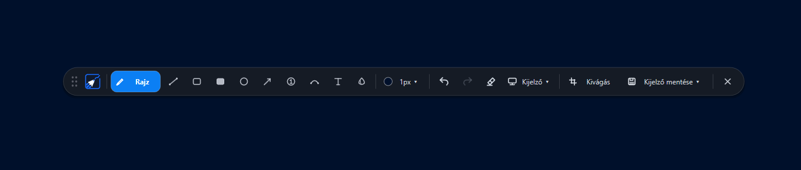
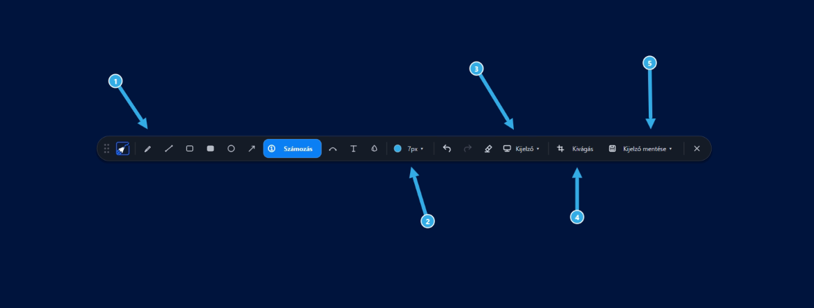
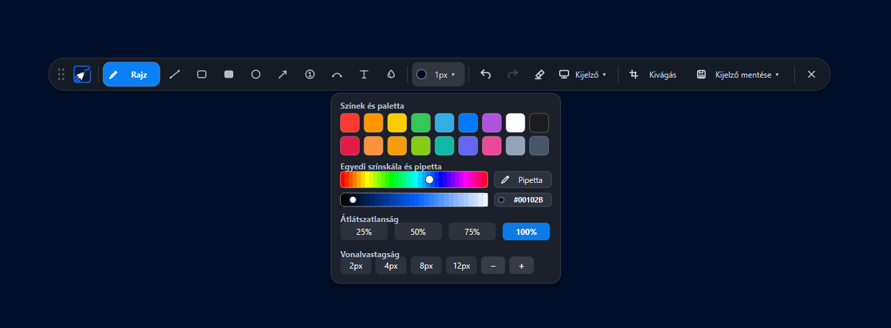
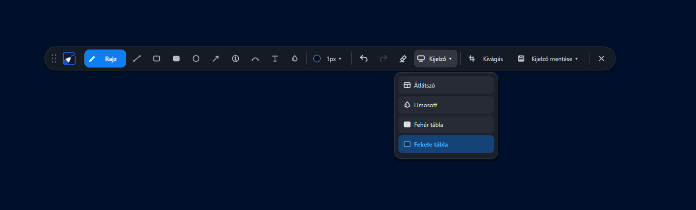
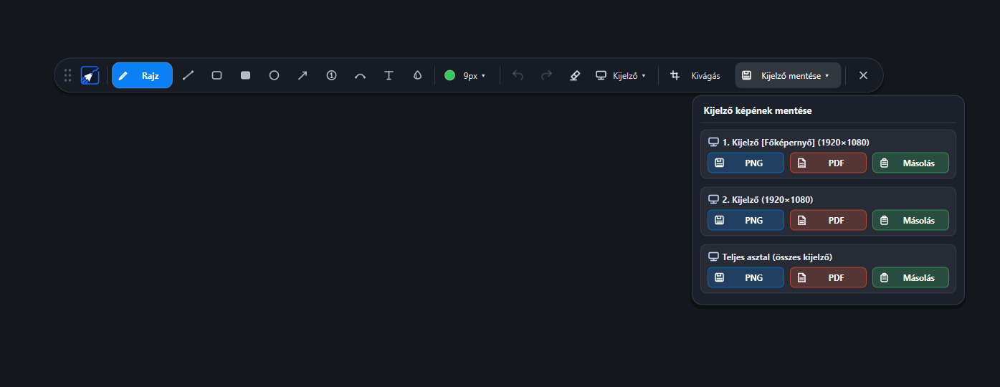

# DrawIt – Detailed Feature Guide & User Manual

  
   
  <strong>DrawIt v0.3.0</strong> 
  <em>Hardware-accelerated, native screen annotator, presenter, and snipping tool for Windows 10 & 11</em>

---

## Table of Contents
1. [Introduction & Architecture](#1-introduction--architecture)
2. [The Floating Toolbar (Dock)](#2-the-floating-toolbar-dock)
3. [The 12 Drawing Tools in Detail](#3-the-12-drawing-tools-in-detail)
4. [Colors, Stroke Thickness & Opacity](#4-colors-stroke-thickness--opacity)
5. [Digital Canvas & Background Modes](#5-digital-canvas--background-modes)
6. [Screen Snipping & Display Exporting](#6-screen-snipping--display-exporting)
7. [Spring Control (Hold-to-Switch) & Hybrid Keys](#7-spring-control-hold-to-switch--hybrid-keys)
8. [Drawing History & Action Management](#8-drawing-history--action-management)
9. [Settings & Customization](#9-settings--customization)
10. [System Tray Controls](#10-system-tray-controls)
11. [Auto-Updater Mechanism](#11-auto-updater-mechanism)
12. [Complete Shortcut & Mouse Action Reference](#12-complete-shortcut--mouse-action-reference)

---

## 1. Introduction & Architecture

**DrawIt** is a single standalone executable (`DrawIt.exe`) designed for lightning-fast screen annotation and visual communication. Tailor-made for educators, software engineers, presenters, and keynote speakers who need instant visual explanations and quick screenshot exports.

### Key Architectural Highlights:
* **Native Rust Implementation**: Zero Electron overhead, zero web-view bloat.
* **Direct2D & DirectWrite GPU Acceleration**: All strokes, shapes, curves, and text are rendered directly via DirectX hardware pipelines with microsecond latency and smooth 60+ FPS performance.
* **Zero External Dependencies**: Requires no .NET Framework, no Visual C++ Redistributable packages, and no external runtimes.
* **100% Portable**: Runs straight from a USB thumb drive or any folder. Configurations persist cleanly in a single `DrawIt.json` file.
* **Extremely Lightweight**: Executable binary size is only ~740 KB, and memory usage is negligible (~15–25 MB).
* **Safe & Privilege-Free**: Runs with standard user privileges (`asInvoker`), never requesting UAC administrator rights.

---

## 2. The Floating Toolbar (Dock)

When DrawIt is activated, an elegant floating dock appears near the top of your display.

### Controls and Anatomy:
1. **Grip Handle (`⋮⋮`)**:
   - Located on the far-left edge of the dock.
   - Click and drag to position the dock anywhere on your monitor (top, bottom, or corners).
2. **Logo Menu Button**:
   - Clicking the DrawIt logo reveals the main application menu: Help (`F1`), Settings, Check for Updates, About, and Exit.
3. **Dynamic Active Tool Indicator**:
   - The selected tool button expands dynamically, displaying its label in plain text (e.g., *“Line”*, *“Arrow”*, *“Snip”*) alongside its vector icon.
4. **Resolution-Independent Sharpness**:
   - All icons are rendered from mathematical Direct2D vector geometries, remaining pixel-sharp across 100%, 125%, 150%, 200%, and 4K DPI scalings.
5. **Quick Action Bar**:
   - **Undo** (`Ctrl + Z`): Reverts the previous stroke.
   - **Redo** (`Ctrl + Y`): Restores the reverted stroke.
   - **Clear All** (`Delete`): Wipes the canvas clean and resets the counter to 1.
   - **Close (`✕`)**: Closes the drawing canvas (or press `Esc` / right-click).

---

## 3. The 12 Drawing Tools in Detail

DrawIt provides 12 specialized tools, each instantly accessible via configurable keyboard shortcuts:

### 1. Freehand Pen – Default Key: `P`
* **Purpose**: Natural handwriting, sketching, circling items, and organic marks.
* **Behavior**: Drag to draw smooth, anti-aliased strokes using your selected color, thickness, and opacity.

### 2. Straight Line – Default Key: `L`
* **Purpose**: Clear dividers, underlines, and direct connections between UI elements.
* **Behavior**: Draws a straight segment from point A to point B.
* **Spring Shortcut**: Holding down **`Shift`** while using any other tool temporarily switches to the Line tool until released.

### 3. Arrow – Default Key: `A`
* **Purpose**: Highlighting menus, buttons, data values, or sequential steps.
* **Behavior**: Draws a straight arrow shaft with a sharp, proportionally scaled arrowhead in the direction of the drag.
* **Spring Shortcut**: Holding down **`Ctrl`** temporarily switches to the Arrow tool.

### 4. Rectangle Outline – Default Key: `R`
* **Purpose**: Framing windows, dialogs, buttons, or input areas.
* **Behavior**: Drag diagonally to construct a clean, hollow rectangular frame with the configured stroke thickness.

### 5. Filled Masking Rectangle – Default Key: `M`
* **Purpose**: Obscuring sensitive or confidential information (passwords, tokens, personal data) instantly.
* **Behavior**: Drag diagonally to create a solid, fully opaque rectangle in the current color.

### 6. Circle / Ellipse – Default Key: `C`
* **Purpose**: Highlighting icons, avatars, numbers, and non-rectangular items.
* **Behavior**: Drag diagonally to produce a smooth, anti-aliased bounding ellipse.

### 7. Numbered Badge Arrow – Default Key: `N`
* **Purpose**: Documenting step-by-step procedures, bug reproduction steps, or tutorials (Step 1, 2, 3...).
* **Behavior**:
  - Places a high-contrast circular badge with an auto-incrementing number at the starting position.
  - Draws a directional arrow towards the target point.
  - Automatically increments the number after each placement (1, 2, 3, 4...).
  - Undoing (`Ctrl + Z`) decrements the counter, and clearing the canvas (`Delete`) resets it to 1.
* **Spring Shortcut**: Holding down **`Ctrl + Shift`** lets you draw numbered arrows on the fly!

  

### 8. 3-Point Quadratic Bézier Curve – Default Key: `V`
* **Purpose**: Drawing curved links, elegant connector arrows, and annotations that bypass overlapping text.
* **Behavior (Two-Phase Drawing)**:
  1. *Phase 1*: Drag from start to end point to define the base span (straight preview).
  2. *Phase 2*: Move the cursor freely to bend the quadratic curve in real time to the desired curvature.
  3. *Commit*: A single click anchors the finished curve.

### 9. Text Input Field – Default Key: `T`
* **Purpose**: Typing notes, titles, and explanations directly onto the screen.
* **Behavior**:
  - Click anywhere on the canvas to place a blinking text cursor.
  - Type your text (full Unicode and accent support).
  - Press `Enter` or click outside to commit the text.
  - Press `Esc` to cancel the current entry.
  - Text scales proportionally with the stroke thickness control (or `Ctrl + MouseWheel`).

### 10. Real-time Gaussian Blur – Default Key: `X`
* **Purpose**: Censor private details, emails, or personal images during live presentations and video recordings.
* **Behavior**: Drag diagonally over any area. DrawIt applies real-time GPU Gaussian blur to the underlying desktop pixels inside the selected rectangle.

### 11. Screen Snipping & Cropping – Default Key: `S`
* **Purpose**: Region capture and instant export.
* **Behavior**: Drag to select any rectangle. The surrounding desktop dims with a vignette mask, and an action bar pops up below the selection.
* **Action Bar Options**:
  - **Copy (`Ctrl + C`)**: Places the capture on the Windows clipboard.
  - **Save PNG (`Ctrl + S`)**: Prompts to save as a lossless PNG file.
  - **Save PDF**: Generates a single-page vector-fitted PDF document.
  - **Cancel (`Esc`)**: Discards the selection.

### 12. Screen Eyedropper (Pipette) – Default Key: `I`
* **Purpose**: Sampling exact pixel colors from existing apps, websites, or images.
* **Behavior**:
  - Activates a **7× zoom loupe** with a pixel grid and crosshair.
  - Displays real-time HEX and RGB color values under the cursor.
  - Clicking sets the sampled color as active and restores your previous drawing tool.

---

## 4. Colors, Stroke Thickness & Opacity

Click the color circle on the floating dock to expand the comprehensive palette and stroke configuration panel.

### 18 Built-in Preset Colors
Organized into two distinct rows:
* **Top Row (Core Colors)**: Red, Orange, Yellow, Green, Cyan, Blue, Purple, White, Black.
* **Bottom Row (Designer Pastel Palette)**: Crimson, Coral, Amber, Lime, Teal, Indigo, Pink, Slate Light, Slate Dark.

### Custom Hue Spectrum & Mixer
When you need an exact shade beyond presets:
* **Continuous Hue Slider**: Full rainbow spectrum selector.
* **Brightness / Saturation Grid**: Fine-tune darker or vivid tones.
* **Live HEX Code**: Real-time display of the current hex value (e.g., `#007AFF`).

### Stroke Thickness
* **Quick Presets**: `2 px` (fine line), `4 px` (standard), `8 px` (bold), `12 px` (thick marker).
* **Fine Stepping**: Increment/decrement with `−` and `+` buttons.
* **Mouse Wheel Control**: Hold **`Ctrl + MouseWheel`** (or scroll directly) to smoothly adjust thickness between 1 px and 32 px on the fly.

### Opacity (Highlighter Support)
Four quick opacity levels:
* **100%**: Fully solid, vibrant marks.
* **75%**: Subtle translucent annotations.
* **50%**: Semi-transparent highlighter effect where underlying screen text remains completely legible.
* **25%**: Soft tint for background highlighting.

---

## 5. Digital Canvas & Background Modes

Through the `Canvas ▾` dropdown, DrawIt transforms between live screen annotation and a presentation whiteboard:

| Canvas Mode | Description | Primary Use Case |
| :--- | :--- | :--- |
| **Transparent (Screen)** | Live desktop and running application windows remain visible beneath your drawings. | Software demos, code reviews, and website walkthroughs. |
| **Blurred Screen** | The desktop receives an elegant Gaussian blur, while your toolbar and annotations stay sharp. | Directing audience focus and minimizing background distractions. |
| **Whiteboard** | Clean, opaque white presentation canvas. | Mathematical explanations, diagrams, and classic lecture notes. |
| **Blackboard** | High-contrast dark board. | Dark mode presentations, eye-friendly nocturnal workflows. |

---

## 6. Screen Snipping & Display Exporting

### 1. Snipping Tool (`S`)
Select any rectangular region to activate the floating action bar:
* **Copy**: Immediate clipboard copy ready for pasting (`Ctrl + V`) into Teams, Slack, Word, or browsers.
* **Save PNG**: Lossless PNG file export.
* **Save PDF**: Direct vector-fitted PDF generation.
* **Cancel**: Dismisses the snip.

### 2. Save Display Menu (`Save Display ▾`)

DrawIt automatically enumerates all connected physical displays:
* **Display 1, Display 2...**: Capture individual monitors with full annotations.
* **Full Desktop (All Displays)**: Merges all monitors into a unified ultra-wide panorama.
* **Formats**: Each option supports **PNG file**, **PDF document**, or **Clipboard copy**.

---

## 7. Spring Control (Hold-to-Switch) & Hybrid Keys

DrawIt incorporates fluid spring-loaded key mechanics inspired by professional design tools:

### Spring Modifiers (Hold to Draw)
* **Hold `Shift`**: Temporarily draws **Straight Lines**; releasing restores your prior tool.
* **Hold `Ctrl`**: Temporarily draws **Arrows**.
* **Hold `Ctrl + Shift`**: Temporarily draws **Numbered Badge Arrows**.

### Hybrid Key Action (Tap vs. Hold)
All 12 tool keys support dual operation:
* **Short Tap (< 250 ms)**: Permanently selects the tool.
* **Hold and Drag**: Temporarily uses the tool while held, switching back upon release.

### Right-Click Instant Dismiss
* Open menus/pickers: **Right-click closes them instantly**.
* Eyedropper or Snip: **Right-click cancels back to pen**.
* In-progress stroke or curve bending: **Right-click cancels the action**.
* Empty canvas: **Right-click dismisses the entire drawing overlay**.

---

## 8. Drawing History & Action Management

* **Undo (`Ctrl + Z`)**: Reverts strokes step-by-step. Intelligently decrements the numbered badge counter.
* **Redo (`Ctrl + Y`)**: Reapplies undone strokes and restores counter progression.
* **Clear Canvas (`Delete` or Trash icon)**: Clears all drawings and resets the number badge to 1.
* **HUD Toast Notifications**: Non-intrusive on-screen toasts confirm copy, save, clear, and curve bending states.

---

## 9. Settings & Customization

Accessible from the Logo menu or the System Tray right-click menu:

### 1. General Tab
* **Language Switcher**: Toggle dynamically between **Magyar** and **English** with zero restart.
* **Global Activation Hotkey**: Choose your preferred global trigger:
  - `Ctrl + 2` (Default)
  - `F8`
  - `Ctrl + Alt + D`
  - `Win + Alt + D`
* **Launch on Windows Startup (Autostart)**: Register/unregister startup registry entry with one toggle.
* **Automatic Update Checks**: Enable or disable background update queries.

### 2. Keybindings Tab
Every single tool key is fully rebindable:
* Click any tool's key card (*"Press a key..."*).
* Press any key (`A`–`Z` or `0`–`9`).
* **Automatic Conflict Swapping**: If a key is already assigned, DrawIt swaps the two assignments automatically, preventing conflicts.
* **Reset Defaults Button**: Restore original keybindings with one click.

### Portable Settings Storage (`DrawIt.json`)
Settings and custom key assignments are saved directly in `DrawIt.json` adjacent to `DrawIt.exe`.

---

## 10. System Tray Controls

DrawIt sits quietly in the Windows notification area:
* **Left-click or Double-click**: Toggles the drawing canvas.
* **Right-click Menu**:
  - **Start Drawing** *(Bold default)*
  - **Settings...**
  - **Run on Windows Startup** *(Checked toggle)*
  - **Check for Updates...**
  - **Help & Shortcuts**
  - **About**
  - **Exit**

---

## 11. Auto-Updater Mechanism

* **Portable GitHub Version**: WinHttp background queries check the GitHub Releases API. When a new release is approved, DrawIt downloads the new executable, safely replaces the running file, and restarts.
* **Microsoft Store Version**: Windows Store handles automatic background updates. The menu option launches the Store Product Detail Page directly.

---

## 12. Complete Shortcut & Mouse Action Reference

### Tools & Keys
| Key | Tool Name | Description |
| :---: | :--- | :--- |
| **`P`** | **Pen / Freehand** | Smooth freehand sketching |
| **`L`** | **Straight Line** | Straight segment between two points |
| **`A`** | **Arrow** | Directional arrow with pointed head |
| **`R`** | **Rectangle** | Hollow frame for highlighting |
| **`M`** | **Mask (Filled Rect)** | Solid opaque mask for sensitive data |
| **`C`** | **Circle / Ellipse** | Elliptical highlight |
| **`N`** | **Numbered Badge** | Auto-incrementing step arrow (1, 2, 3...) |
| **`V`** | **Bézier Curve** | Two-phase quadratic curved connector |
| **`T`** | **Text** | Click-to-type with Unicode support |
| **`X`** | **Gaussian Blur** | Real-time GPU blur for censorship |
| **`S`** | **Snip** | Area selection with floating action bar |
| **`I`** | **Pipette / Eyedropper**| 7× zoom loupe with real-time HEX preview |

### Spring Modifiers (Hold Key)
| Combination | Behavior |
| :--- | :--- |
| **Hold `Shift`** | Temporarily activates **Line** tool |
| **Hold `Ctrl`** | Temporarily activates **Arrow** tool |
| **Hold `Ctrl + Shift`** | Temporarily activates **Numbered Badge Arrow** |
| **Hold Tool Key** | Uses tool while held, reverts on release |

### System & Mouse Shortcuts
| Shortcut / Action | Function |
| :--- | :--- |
| **`Ctrl + 2`** *(or `F8`, `Ctrl+Alt+D`, `Win+Alt+D`)* | Global hotkey to open/close drawing canvas |
| **`Ctrl + MouseWheel`** | Adjust stroke thickness / font size (1–32 px) |
| **`Right-Click`** | Dismiss menu / Cancel eyedropper or snip / Close overlay |
| **`Esc`** | Cancel active snip / Discard text / Close overlay |
| **`Ctrl + Z`** | Undo previous stroke |
| **`Ctrl + Y`** | Redo stroke |
| **`Delete`** | Clear canvas & reset number counter to 1 |
| **`Ctrl + C`** | Copy snip selection to clipboard |
| **`Ctrl + S`** | Save current screenshot to PNG |
| **`F1`** | Show Help dialog |

---

  <strong>DrawIt</strong> – Crafted for fast, fluid, and professional screen communication. 
  © 2026 DrawIt Team. All rights reserved.

