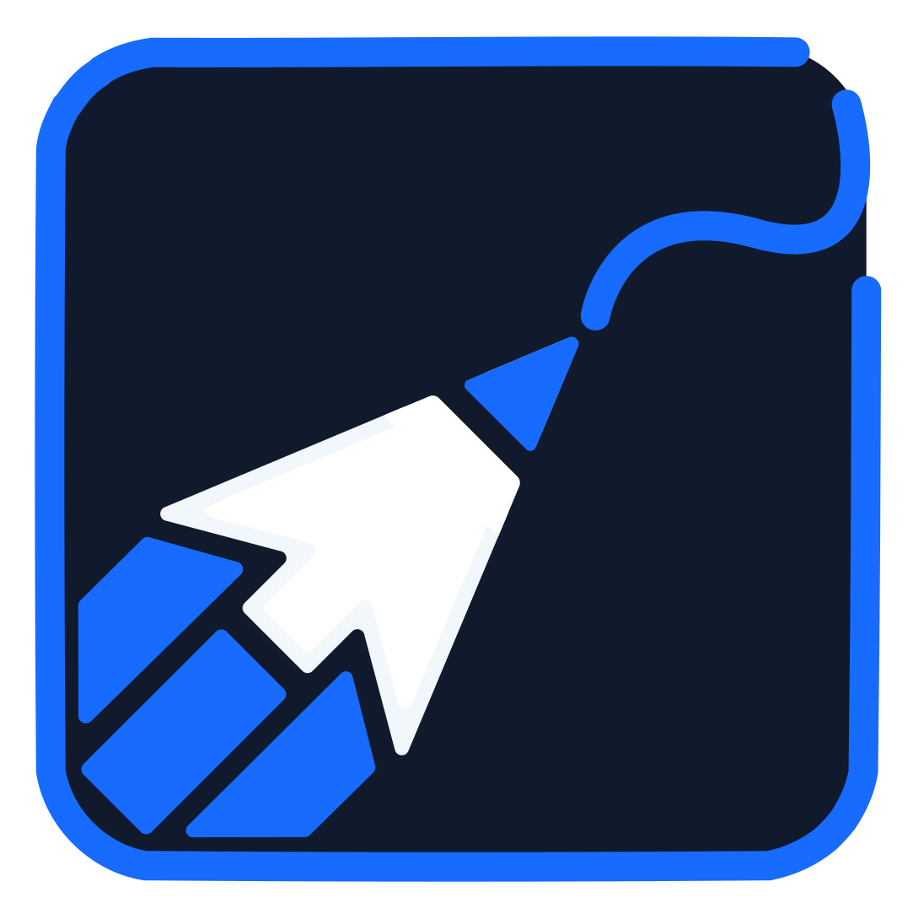
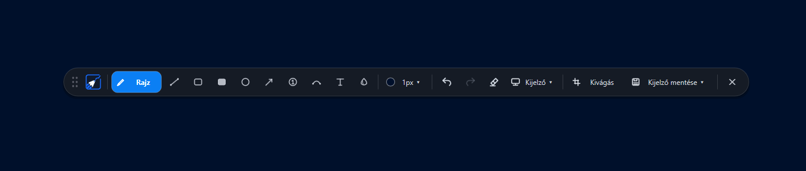
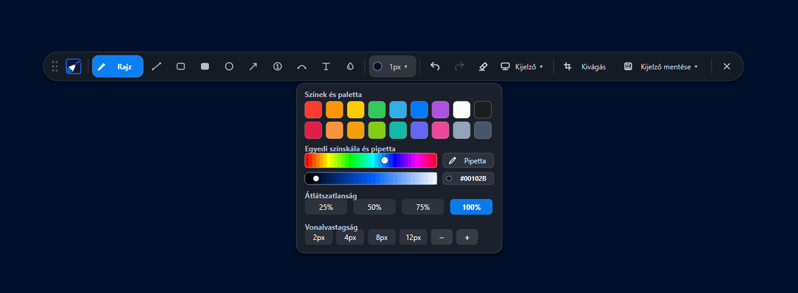
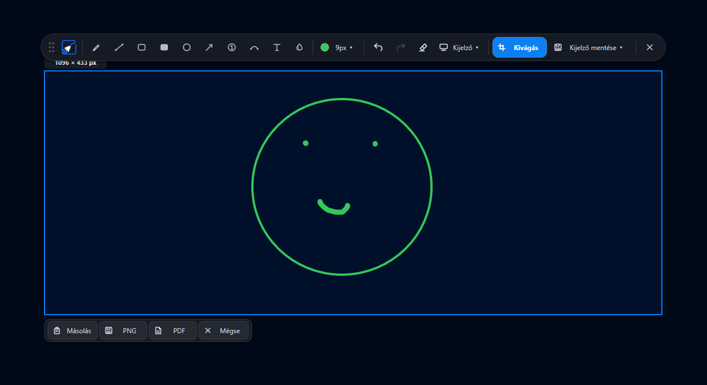
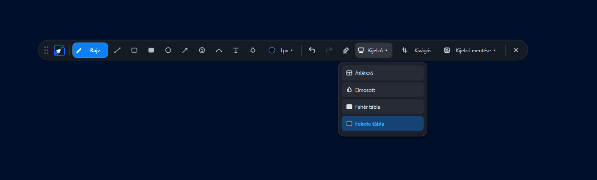
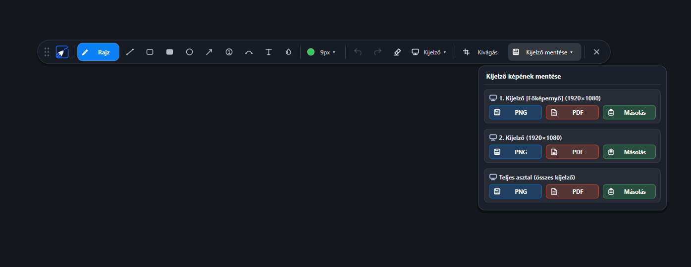

# DrawIt – Fast & Portable Screen Annotation Tool

<p align="center">
  
  <br>
  <strong>DrawIt v0.3.0</strong>
  <br>
  <em>Lightning-fast, portable screen annotator, presenter, and snipping tool for Windows 10 & 11</em>
  <br><br>
  <a href="README.md"><strong>Magyar</strong></a> | <a href="README.en.md"><strong>English</strong></a> | <a href="FEATURES.md"><strong>Detailed Features</strong></a>
</p>

---

> [!TIP]
> **Comprehensive Feature Guide & User Manual:**
> For an in-depth breakdown of all 12 tools, spring-loaded key mechanics, color mixer, and digital canvas modes, see the **[Detailed Feature Guide (FEATURES.md)](FEATURES.md)**!

---

## Overview

**DrawIt** is a single standalone, high-speed, hardware-accelerated screen drawing and annotation tool. Built specifically for educators, developers, keynote speakers, and daily presentation workflows where instant visual explanations and quick screenshot exports are essential.

Built in 100% native **Rust** with direct **Direct2D** and **DirectWrite** GPU acceleration:
* **Zero External Dependencies**: Does not require .NET Framework, Visual C++ Redistributable packages, or any external runtimes.
* **100% Portable**: No installation required, zero Windows Registry clutter, runs directly from a USB drive or any local folder.
* **Built-in Auto-Updater**: Directly queries GitHub Releases in the background via native WinHttp. When a new version is available, updates itself in-place with a single click.
* **Instant Right-Click Dismiss & Exit**: Any open popup, eyedropper, active drawing stroke, or the canvas itself can be dismissed instantly with a right click.
* **No Administrator Rights Needed**: Launches immediately with standard user privileges (`asInvoker`).
* **Minimal Footprint**: Binary size is only **~850 KB**, memory footprint is tiny (~15–25 MB), and reacts with microsecond latency.

---

## Screenshots & Features

### 1. Floating Toolbar (Dock)


* **Freely Draggable**: Grab the left handle (`⋮⋮`) to move the dock anywhere on your screen.
* **Dynamic Tool Display**: The active tool button expands with an elegant text label, while inactive tools remain compact.
* **100% Vector Graphics**: Every single icon and logo is drawn using hardware-accelerated Direct2D vector geometry—pin-sharp across 100%, 125%, 150%, and 200% DPI scaling.

---

### 2. Color Palette, Spectrum & Eyedropper


* **18 Built-in Preset Colors**: Quick selection of standard and designer pastel shades.
* **Custom Hue & Lightness Mixer**: Fine-tune any custom color with live HEX code preview.
* **Screen Eyedropper**: Sample any pixel from your screen with a 7× zoom loupe and crosshair.
* **Opacity & Stroke Width**: 25%, 50%, 75%, 100% opacity presets and 2px–12px quick thickness buttons, along with `−` / `+` fine adjustment or scroll wheel control.

---

### 3. Screen Snipping & Cropping


* **Flexible Region Selection**: Snip any rectangular portion of the display.
* **Instant Action Bar**:
  * **Save PNG**: Export lossless image file.
  * **Save PDF**: Generate a single-page vector-fitted PDF document.
  * **Copy to Clipboard**: Instant clipboard copy for direct pasting into Slack, Teams, Word, or web browsers (`Ctrl + V`).

---

### 4. Digital Canvas Modes


Choose from 4 presentation backdrops from the `Canvas ▾` menu:
* **Transparent (Screen)**: Live annotation directly over your desktop and active windows.
* **Blurred Screen**: Elegant background blur so annotations pop out clearly.
* **Whiteboard**: Clean white presentation whiteboard.
* **Blackboard**: Modern dark chalkboard for high-contrast sketching.

---

### 5. Multi-Monitor Display Export


* Select individual connected displays or capture the entire virtual desktop span.
* Export to PNG, PDF, or copy directly to clipboard with a single click.

---

## Shortcuts & Spring-Loaded Tools (Hold-to-Switch)

DrawIt features professional spring-loaded ("hold-to-switch") tool switching: hold down a key to temporarily switch tools, and release it to instantly snap back to your previous tool.

### Spring Modifier Keys (Hold down)
| Key | Temporary Tool | Behavior |
| :--- | :--- | :--- |
| **`Shift`** | **Straight Line (Line)** | Hold to draw straight lines; release to return to previous tool |
| **`Ctrl`** | **Process Arrow (Arrow)** | Hold to draw arrows; release to return to previous tool |
| **`Ctrl + Shift`** | **Numbered Badge** | Hold to draw sequential step-by-step numbered arrows (1, 2, 3...) |

### Hybrid Tool Shortcuts (Quick Tap = Switch | Hold = Spring-Loaded Temporary)
| Default Key | Tool | Description |
| :--- | :--- | :--- |
| **`P`** | **Pen / Freehand** | Smooth freehand drawing |
| **`L`** | **Line** | Straight line tool |
| **`A`** | **Arrow** | Directional pointer arrow |
| **`R`** | **Rectangle** | Outline rectangle framing |
| **`M`** | **Mask** | Solid filled rectangle to conceal sensitive information |
| **`C`** | **Circle** | Circle / ellipse outline |
| **`N`** | **Numbered Badge** | Step-by-step numbered marker |
| **`V`** | **Curved Line** | 3-point curved arc |
| **`T`** | **Text** | Direct on-screen typography |
| **`X`** | **Blur** | Instantly blur sensitive areas |
| **`S`** | **Snip** | Rectangular snip and export |
| **`I`** | **Picker / Eyedropper** | Sample any pixel color from screen |

### General & Global Shortcuts
| Shortcut | Action |
| :--- | :--- |
| **`Ctrl + 2`** *(or `F8`, `Ctrl + Alt + D`, `Win + Alt + D`)* | Toggle drawing overlay from anywhere in Windows (customizable) |
| **`Ctrl + Mouse Wheel`** *(or wheel)* | Smooth stroke thickness & text size adjustment (1–32 px) |
| **`Esc`** *(or Right Click)* | Close overlay / Dismiss popups / Cancel snip or eyedropper |
| **`Ctrl + Z`** | Undo |
| **`Ctrl + Y`** | Redo |
| **`Delete`** | Clear all drawings and reset badge counter to #1 |
| **`Ctrl + C`** | Copy snipped region or display to clipboard |
| **`Ctrl + S`** | Quick export display to PNG |
| **`F1`** | Open help and shortcut guide |

---

## Settings & Portability

Open the **Settings** dialog from the toolbar logo menu or tray icon:
* **General Tab**:
  * **Language**: Dynamically switch between English and Magyar.
  * **Global Activation Hotkey**: Choose from `Ctrl+2`, `F8`, `Ctrl+Alt+D`, or `Win+Alt+D`.
  * **Start with Windows (Autostart)**: Optional silent tray startup on user login.
  * **Automatic Update Checks**: Toggle startup GitHub release checking.
* **Keybindings Tab (Fully Customizable Shortcuts)**:
  * Customize shortcuts for all 12 drawing tools with a single click and pressing your desired key (`A`–`Z` or `0`–`9`).
  * Smart key swap: assigning an existing key automatically swaps with the previous tool to prevent conflicts.
  * Single-click factory reset (*Reset to Default Keys*).
* **Portable Configuration**: All settings and custom keybindings are automatically stored in `DrawIt.json`, keeping your preferences intact when running from a USB stick.

---

## Installation & Running

DrawIt is available in multiple formats on [**GitHub Releases**](https://github.com/csuszy/DrawIt/releases/latest):

* **Portable Version (Recommended)**: `DrawIt.exe` or `Standalone_Files.zip` – zero installation, runs anywhere (including USB drives).
* **Microsoft Store / MSIX Package**: [Get it from Microsoft Store](ms-windows-store://pdp/?productid=9NHQC57FT5LQ) or download the standalone `DrawIt.msix` package.
* **Windows Installer**: `DrawIt-Setup.exe` – classic setup wizard with Start Menu integration (per-user install, no admin privileges required).

### Getting Started
1. Download your preferred package from [**GitHub Releases**](https://github.com/csuszy/DrawIt/releases/latest).
2. Launch the application.
3. DrawIt sits quietly in your system tray notification area. Press **`Ctrl + 2`** anytime to start drawing.
4. Updates: DrawIt automatically notifies you when new releases are available, or check anytime from the menu via *Check for Updates...*.

> [!NOTE]
> **Windows SmartScreen Notice:**
> For new standalone executables not yet signed with an enterprise certificate, Windows may display a blue SmartScreen prompt. Click **More info** and then **Run anyway**.

---

## Building from Source

Build using standard Rust tools:

```powershell
# Prerequisites: Rust 1.75+ (MSVC toolchain on Windows 10/11)
git clone https://github.com/csuszy/DrawIt.git
cd DrawIt

# Debug build
cargo build

# Optimized release build (~850 KB)
cargo build --release
```

The compiled binary will be placed at `target/release/drawit.exe`.

---

## License

This software is freely available for personal and commercial use.
All rights reserved © 2026 DrawIt Team.
