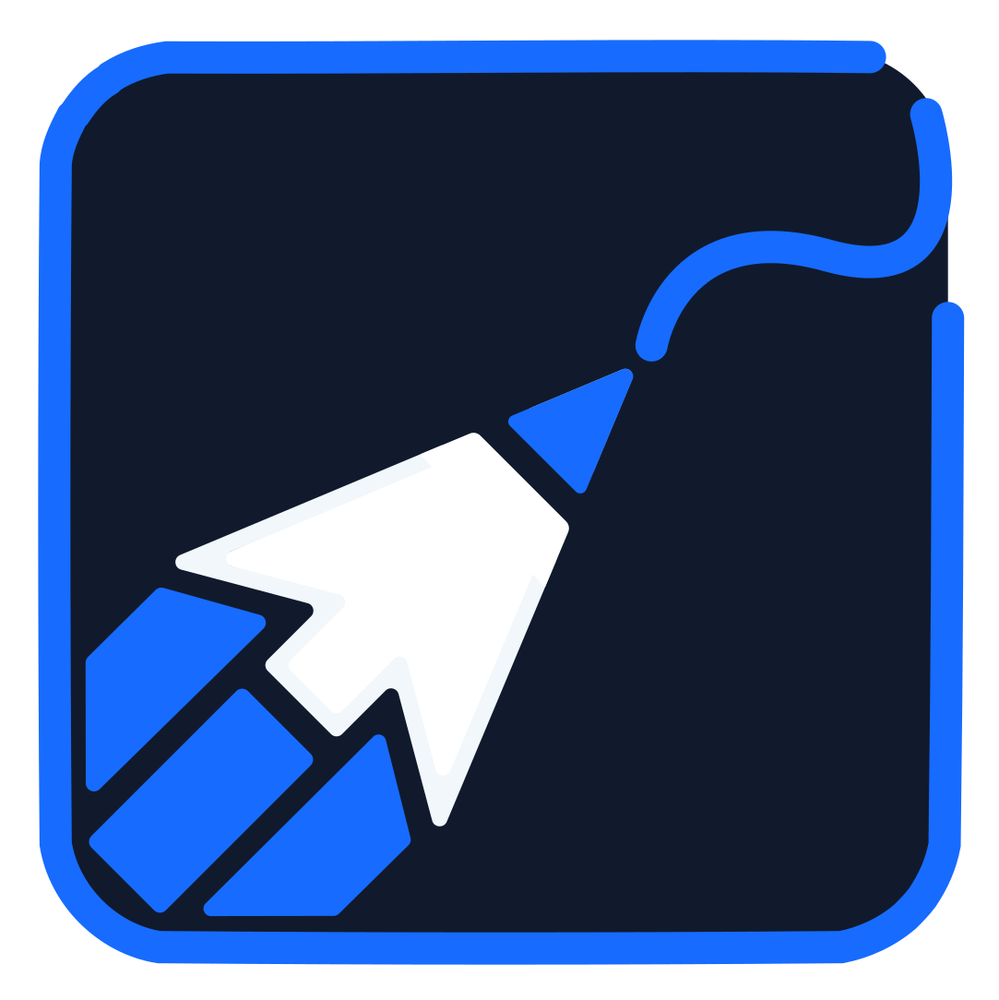
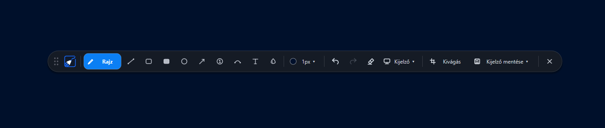
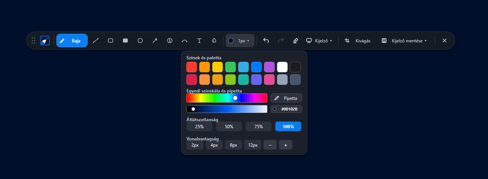
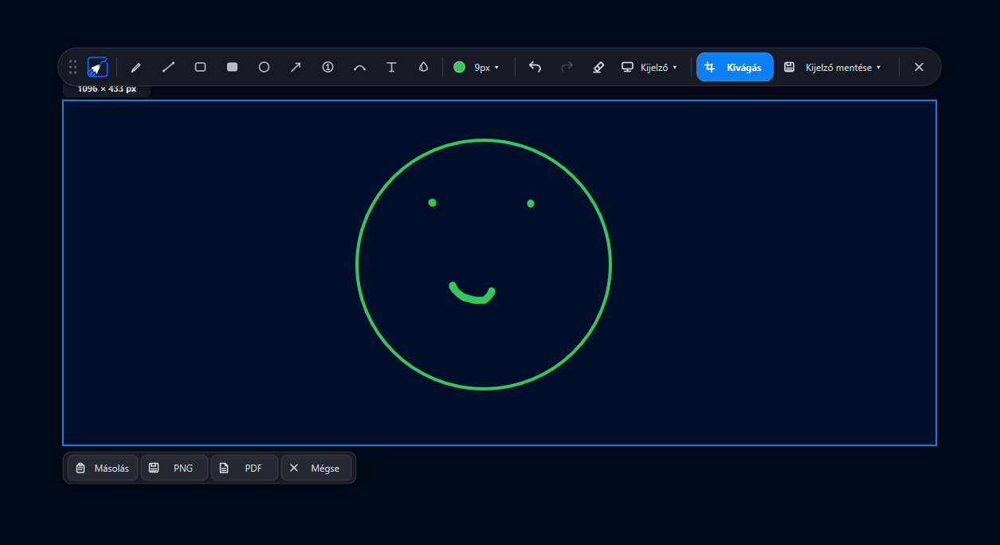
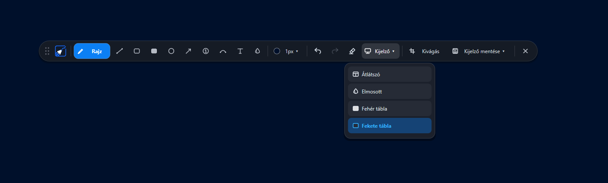
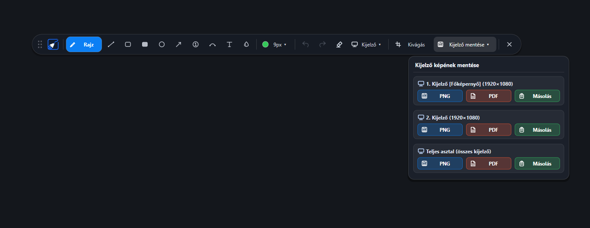
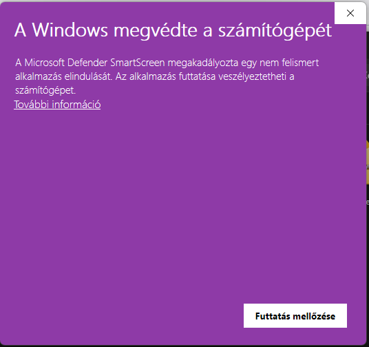
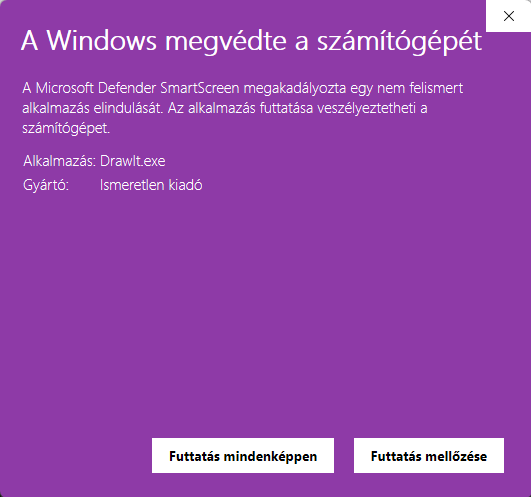

# DrawIt – Gyors és Hordozható Képernyőrajzoló

<p align="center">
  
  <br>
  <strong>DrawIt v0.1 (Rust Kiadás)</strong>
  <br>
  <em>Villámgyors, hordozható képernyőannotáló, magyarázó és képmetsző segédprogram Windows 10 és 11 rendszerekre</em>
</p>

---

## Áttekintés

A **DrawIt** egyetlen önálló, rendkívül gyors és hardveresen gyorsított képernyőrajzoló eszköz. Kifejezetten oktatóknak, fejlesztőknek, bemutatót tartó előadóknak és mindennapi munkához készült, ahol fontos a képernyő azonnali feliratozása, magyarázata és a képernyőképek gyors exportálása.

Teljesen natív **Rust** nyelven készült, közvetlen **Direct2D** és **DirectWrite** grafikus gyorsítással:
* **Nulla külső függőség**: Nem igényel .NET keretrendszert, Visual C++ Redistributable csomagokat, sem más futtatókörnyezetet.
* **100% Hordozható (Portable)**: Nem igényel telepítést, nem szemetel a rendszerleíró adatbázisban, közvetlenül pendrive-ról vagy bármilyen mappából futtatható.
* **Nem kér rendszergazdai jogot**: Standard felhasználói jogosultságokkal (`asInvoker`) azonnal elindul.
* **Minimális erőforrásigény**: Fájlmérete mindössze **~740 KB**, memóriahasználata elenyésző (~15-25 MB), és mikromásodperces késleltetéssel reagál.

---

## Képernyőképek és Funkciók

### 1. Lebegő vezérlősáv (Dokk)


* **Szabadon áthelyezhető**: A bal szélső fogantyúnál (`⋮⋮`) megfogva a képernyő bármely részére húzható.
* **Dinamikus eszközkijelzés**: A kiválasztott rajzeszköz gombja elegánsan kinyílik, és felirattal jeleníti meg a nevét, míg az inaktív ikonok kompaktak maradnak.
* **100% Vektoros grafika**: Minden egyes ikon és a logó is hardveresen gyorsított Direct2D vektoros geometriával rajzolódik ki, így 100%, 125%, 150% és 200% DPI-skálázás mellett is tökéletesen éles.

---

### 2. Színválasztó, Spektrum és Pipetta


* **18 beépített gyorsszín**: Standard és dizájner pasztell árnyalatok azonnali kiválasztása.
* **Egyedi színskála (Hue & Lightness)**: Finomhangolható színkeverő élő HEX színkód kijelzéssel.
* **Képernyő-Pipetta**: Színmintavételezés a képernyő bármely pontjáról 7×-es nagyítóval és célkereszttel.
* **Átlátszatlanság és Vonalvastagság**: 25%, 50%, 75%, 100% opacitás és 2px–12px gyorsméretek, valamint `−` / `+` finombeállítás.

---

### 3. Képernyőkivágás és Mentés


* **Rugalmas területkijelölés**: Tetszőleges képernyőrészlet kijelölése.
* **Azonnali gombsor**:
  * **PNG mentés**: Veszteségmentes képfájlba mentés.
  * **PDF mentés**: Vektoros PDF dokumentum generálása a kijelölt területről.
  * **Másolás**: Azonnali vágólapra helyezés más alkalmazásokba (Teams, Slack, Word, böngésző) való közvetlen beillesztéshez (`Ctrl + V`).

---

### 4. Digitális Vászon Módok


A `Kijelző ▾` menüből négyféle munkakörnyezet választható:
* **Átlátszó**: Élő asztal és alkalmazások annotálása.
* **Elmosás (Blur)**: Az asztal hátterének elegáns elhomályosítása, hogy a magyarázatok kiemelkedjenek.
* **Fehértábla**: Klasszikus fehér prezentációs tábla.
* **Feketetábla**: Modern sötét jegyzettábla.

---

### 5. Többmonitoros Export


* Külön-külön kiválasztható bármely csatlakoztatott monitor vagy a teljes virtuális asztal.
* Egyetlen kattintással menthető PNG vagy PDF formátumban, illetve másolható vágólapra.

---

## Gyorsbillentyűk

| Billentyűkombináció | Funkció |
| :--- | :--- |
| **`Ctrl + 2`** *(vagy `Ctrl + Alt + D`)* | Rajzolófelület be- és kikapcsolása bárhonnan a rendszerből |
| **`Ctrl + Egérgörgő`** *(vagy görgő)* | Vonalvastagság / Szövegméret azonnali fokozatmentes állítása |
| **`Esc`** *(vagy Jobb egérgomb)* | Rajzolás bezárása / Menük elvetése / Kijelölés törlése |
| **`Ctrl + Z`** | Visszavonás (Undo) |
| **`Ctrl + Y`** | Újra (Redo) |
| **`Delete`** | Rajzvászon letörlése és számláló újraindítása 1-ről |
| **`Ctrl + C`** | Kijelölt terület másolása a vágólapra |
| **`Ctrl + S`** | Aktuális képernyőkép mentése PNG fájlba |
| **`F1`** | Gyorsbillentyű-súgó megjelenítése |

---

## Telepítés és Futtatás

### Közvetlen futtatás
1. Töltse le a [**`DrawIt.exe`**](DrawIt.exe) fájlt vagy a [**`Standalone_Files.zip`**](Standalone_Files.zip) archívumot.
2. Indítsa el a **`DrawIt.exe`** programot.
3. A szoftver a tálca értesítési területén fut a háttérben. A **`Ctrl + 2`** billentyűkombinációval bármikor előhívható.

> [!NOTE]
> **Windows SmartScreen figyelmeztetés:**
> Digitális tanúsítvánnyal még nem aláírt új önálló futtatható fájlok esetén a Windows megjelenítheti a kék védelmi ablakot. Kattintson a **További információ** gombra, majd a **Futtatás mindenképp** lehetőségre.
> <br><br>
> 
> &nbsp;&nbsp;&nbsp;
> 

---

## Fordítás forrásból

A projekt szabványos Rust eszköztárral építhető:

```powershell
# Követelmény: Rust 1.75+ (MSVC toolchain Windows 10/11-en)
git clone https://github.com/csuszy/DrawIt.git
cd DrawIt

# Debug build
cargo build

# Optimalizált, minimális méretű release build (~740 KB)
cargo build --release
```

A kész bináris a `target/release/drawit.exe` útvonalon jön létre.

---

## Licenc

Ez a szoftver személyes és üzleti célokra szabadon használható és terjeszthető.
Minden jog fenntartva © 2026 DrawIt Team.
