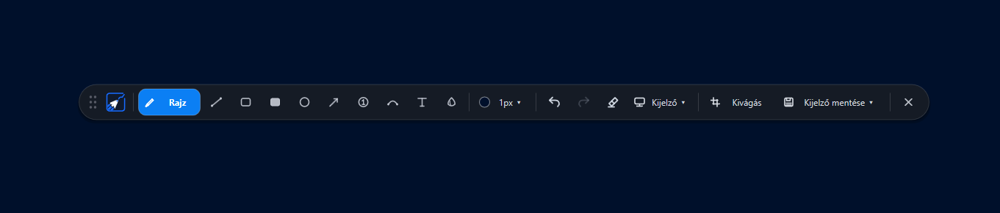
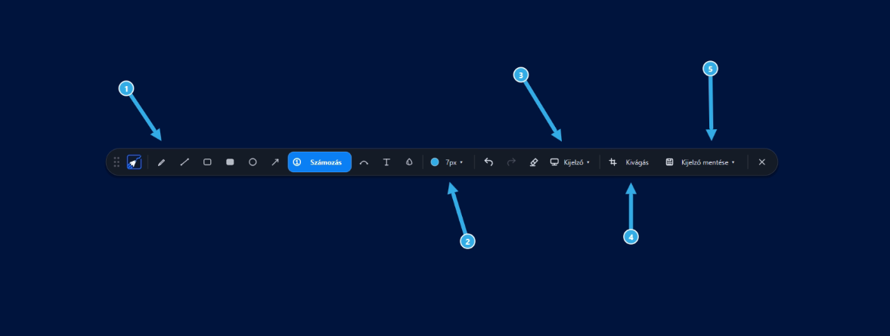
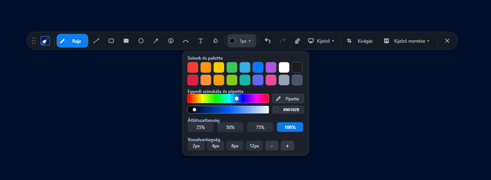
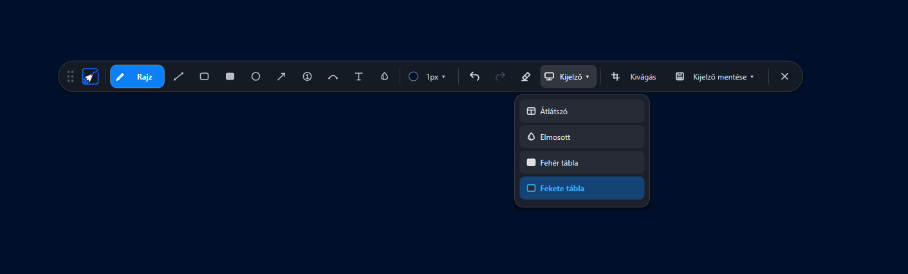
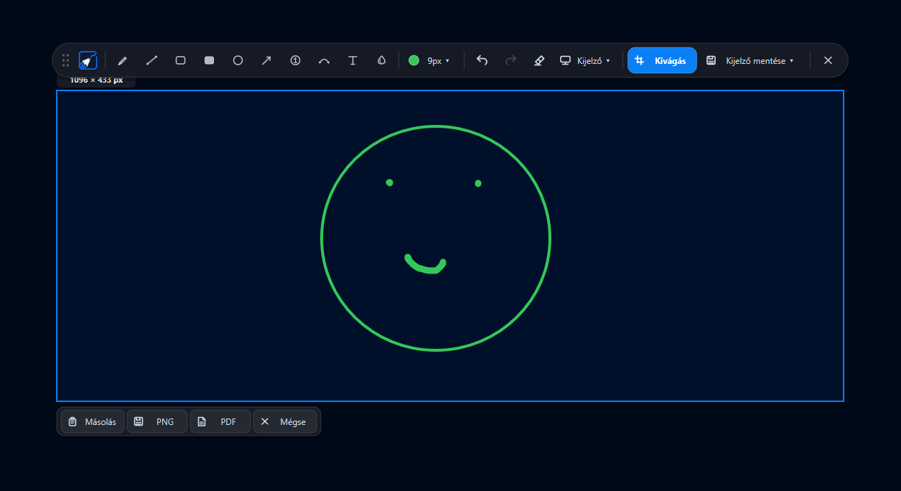
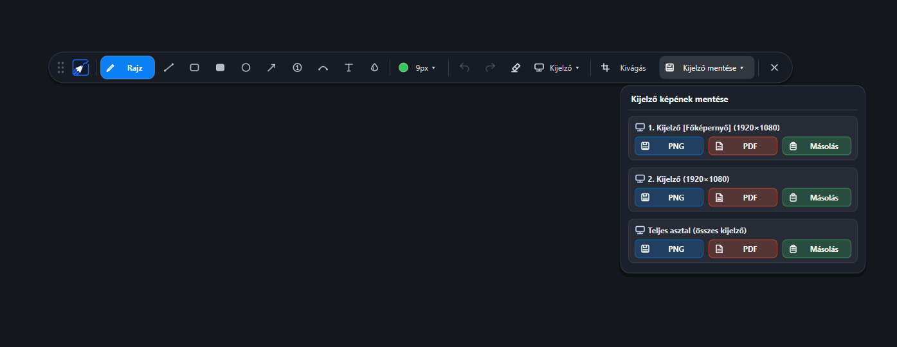

# DrawIt – Részletes Funkcióleírás és Felhasználói Kézikönyv

  
   
  <strong>DrawIt v0.3.0</strong> 
  <em>Hardveresen gyorsított, natív képernyőannotáló, magyarázó és képmetsző eszköz Windows 10 és 11 rendszerekre</em>

---

## Tartalomjegyzék
1. [Bevezetés és Rendszerarchitektúra](#1-bevezetés-és-rendszerarchitektúra)
2. [A Lebegő Vezérlősáv (Dokkoló)](#2-a-lebegő-vezérlősáv-dokkoló)
3. [A 12 Rajzeszköz Részletes Ismertetése](#3-a-12-rajzeszköz-részletes-ismertetése)
4. [Színek, Vonalvastagság és Átlátszóság](#4-színek-vonalvastagság-és-átlátszóság)
5. [Digitális Vászon- és Háttérmódok](#5-digitális-vászon--és-háttérmódok)
6. [Képmetszés (Snip) és Képernyőexportálás](#6-képmetszés-snip-és-képernyőexportálás)
7. [Rugós Vezérlés (Hold-to-Switch) és Hibrid Billentyűkezelés](#7-rugós-vezérlés-hold-to-switch-és-hibrid-billentyűkezelés)
8. [Rajztörténet és Műveletkezelés](#8-rajztörténet-és-műveletkezelés)
9. [Beállítások és Testreszabás](#9-beállítások-és-testreszabás)
10. [Rendszertálca (System Tray) Vezérlés](#10-rendszertálca-system-tray-vezérlés)
11. [Automatikus Frissítéskezelő](#11-automatikus-frissítéskezelő)
12. [Gyorsbillentyűk és Egérműveletek Összefoglaló Táblázata](#12-gyorsbillentyűk-és-egérműveletek-összefoglaló-táblázata)

---

## 1. Bevezetés és Rendszerarchitektúra

A **DrawIt** egyetlen önálló futtatható állományból (`DrawIt.exe`) álló, rendkívül gyors képernyőrajzoló segédprogram. Kifejezetten oktatók, szoftverfejlesztők, online előadók és prezentációkat tartó szakemberek számára készült, ahol elengedhetetlen a képernyő azonnali feliratozása, magyarázata és a képi kivágások gyors továbbítása.

### Főbb technológiai jellemzők:
* **Natív Rust alapok**: Nincs Electron, nincs webes futtatókörnyezet, nincs szükségköltség.
* **Direct2D és DirectWrite hardveres gyorsítás**: Minden vonal, görbe, ikon és szöveg közvetlenül a grafikus processzoron (GPU) renderelődik, mikromásodperces válaszidővel és 60+ FPS simasággal.
* **Nulla külső függőség**: Nem igényel sem .NET-et, sem Visual C++ Redistributable csomagokat, sem más telepítőt.
* **100% Hordozható (Portable)**: Közvetlenül pendrive-ról vagy bármilyen mappából futtatható. A beállításokat egyetlen helyi `DrawIt.json` fájlban rögzíti.
* **Minimális erőforrásigény**: A futtatható fájl mérete mindössze ~740 KB, futásidejű memóriahasználata pedig elenyésző (~15–25 MB).
* **Biztonságos és jogosultságkímélő**: Hagyományos felhasználói jogosultságokkal (`asInvoker`) fut, soha nem kér rendszergazdai (UAC) megerősítést.

---

## 2. A Lebegő Vezérlősáv (Dokkoló)

Amikor a DrawIt rajzolófelülete aktív, a képernyő felső részén egy elegáns, lebegő vezérlősáv jelenik meg.

### Kezelése és elemei:
1. **Mozgató fogantyú (`⋮⋮`)**:
   - A dokkoló bal szélén található dupla pöttyös terület.
   - Bal egérgombbal nyomva tartva a sáv a képernyő bármely pontjára áthúzható (pl. a képernyő aljára, tetejére vagy sarkába).
2. **Logo menügomb**:
   - A DrawIt ikonra kattintva lenyílik a főmenü, ahonnan elérhető a Súgó (`F1`), a Beállítások, a Frissítések keresése, a Névjegy, valamint a Kilépés.
3. **Dinamikus aktív eszköz gomb**:
   - Az éppen kiválasztott rajzeszköz gombja kiszélesedik, kiemelt hátteret kap és szövegesen is kiírja az eszköz nevét (pl. *„Vonal”*, *„Nyíl”*, *„Kivágás”*).
4. **Végtelen élesség (DPI-függetlenség)**:
   - Minden egyes ikon hardveresen számolt Direct2D vektoros görbékből áll. Bármilyen képernyőfelbontáson és skálázáson (100%, 125%, 150%, 200%, 4K) borotvaéles marad.
5. **Gyorsműveletek sáv**:
   - **Visszavonás** (`Ctrl + Z`): utolsó vonás visszavonása.
   - **Újra** (`Ctrl + Y`): visszavont vonás visszaállítása.
   - **Törlés** (`Delete`): a teljes vászon letisztítása és a számozás visszaállítása 1-re.
   - **Bezárás (`✕`)**: a rajzfelület azonnali bezárása (vagy `Esc`, illetve jobb egérkattintás).

---

## 3. A 12 Rajzeszköz Részletes Ismertetése

A DrawIt tizenkét dedikált eszközt biztosít, amelyek a billentyűzetről azonnal elérhetők:

### 1. Szabadkézi Toll / Ceruza (Pen) – Alapértelmezett gomb: `P`
* **Mire való**: Természetes kézírás, vázlatok, bekarikázás, szabadkézi kiemelés.
* **Működése**: Az egér bal gombjának lenyomásával és húzásával folyamatos, élsimított vonal húzható. A kiválasztott szín, átlátszóság és vonalvastagság érvényesül.

### 2. Egyenes Vonal (Line) – Alapértelmezett gomb: `L`
* **Mire való**: Pontos elválasztók, aláhúzások, diagramkapcsolatok rajzolása.
* **Működése**: Kezdőponttól a végpontig egyenes szakaszt húz.
* **Gyorsrugós vezérlés**: Bármely más eszköz használata közben a **`Shift` billentyűt lenyomva tartva** a program azonnal átvált Vonal eszközre. Elengedéskor visszatér az eredeti eszközre.

### 3. Folyamatnyíl (Arrow) – Alapértelmezett gomb: `A`
* **Mire való**: Fontos részletekre, gombokra, menüpontokra vagy logikai lépésekre történő határozott rámutatás.
* **Működése**: Egyenes szárat húz, amelynek végén automatikusan egy arányos, hegyes nyílfej jelenik meg a húzás irányában.
* **Gyorsrugós vezérlés**: Bármely eszköz mellett a **`Ctrl` billentyűt nyomva tartva** azonnal folyamatnyíl rajzolható.

### 4. Téglalap Keret (Rectangle) – Alapértelmezett gomb: `R`
* **Mire való**: Gombok, beviteli mezők, táblázatrészletek vagy képernyőterületek bekeretezése és fókuszba állítása.
* **Működése**: Átlós húzással üres körvonalas téglalapot rajzol a beállított vonalvastagsággal.

### 5. Kitöltött Téglalap / Takarómaszk (Mask) – Alapértelmezett gomb: `M`
* **Mire való**: Érzékeny, bizalmas adatok (jelszavak, személyes adatok, bankszámlaszámok, belső azonosítók) azonnali elfedése a képernyőn.
* **Működése**: Átlós húzással teljesen tömör, átlátszatlan téglalapmaszkot hoz létre az aktuálisan kiválasztott színnel.

### 6. Kör / Ellipszis (Circle) – Alapértelmezett gomb: `C`
* **Mire való**: Ikonok, avatarok, számok vagy nem szögletes elemek kiemelése.
* **Működése**: Átlós húzással a befoglaló téglalapba illeszkedő, szabályos és simított körvonalas ellipszist rajzol.

### 7. Számozott Jelölő és Nyíl (Numbered Badge) – Alapértelmezett gomb: `N`
* **Mire való**: Többlépéses folyamatok, útmutatók és oktatóanyagok lépésről-lépésre történő illusztrálása (1., 2., 3. lépés).
* **Működése**:
  - A kezdőpontnál elhelyez egy elegáns, kontrasztos, sorszámozott kört (Badge).
  - A végpontig egy iránymutató nyilat húz.
  - A számláló minden sikeres rajzolás után **automatikusan növekszik eggyel** (1, 2, 3, 4...).
  - Visszavonáskor (`Ctrl + Z`) a számláló visszalép, a vászon letisztításakor (`Delete`) pedig visszaáll 1-re.
* **Gyorsrugós vezérlés**: A **`Ctrl + Shift` billentyűkombinációt nyomva tartva** bármikor azonnal számozott nyíl rajzolható!

  

### 8. Hárompontos Bézier Ív (Curve) – Alapértelmezett gomb: `V`
* **Mire való**: Elegáns, ívelt kapcsolatok, organikus folyamatnyilak és diagramok rajzolása, amelyek elkerülik a képernyőn lévő egyéb szövegeket.
* **Működése (Kétfázisú intelligens rajzolás)**:
  1. *1. fázis*: Kattintással és húzással kijelölöd az ív kezdő- és végpontját (egyenes előnézet).
  2. *2. fázis*: Az egér felengedése után az egérmutató mozgatásával valós időben hajlíthatod meg a másodfokú Bézier görbét a kívánt irányba és ívre.
  3. *Lezárás*: Egyetlen kattintás rögzíti a kész görbét.

### 9. Szövegbeviteli Mező (Text) – Alapértelmezett gomb: `T`
* **Mire való**: Megjegyzések, címkék, kiegészítő magyarázatok közvetlen gépelése a képernyőre.
* **Működése**:
  - Kattints a képernyő kívánt pontjára: azonnal megjelenik a villogó szövegkurzor.
  - Gépeld be a magyarázatot (teljes Unicode és magyar ékezetes karaktertámogatás).
  - Az `Enter` leüti a szöveget és rögzíti a vásznon.
  - Az `Esc` gombbal a megkezdett szövegbevitel elvethető.
  - A szöveg mérete a vonalvastagság állításával (vagy `Ctrl + Egérgörgővel`) arányosan skálázódik.

### 10. Valós Idejű Elmosás / Cenzúrázás (Blur) – Alapértelmezett gomb: `X`
* **Mire való**: Képernyőrészek optikai elhomályosítása, érzékeny képek vagy szövegek gyors cenzúrázása videófelvételek vagy prezentációk alatt.
* **Működése**: Átlós húzással jelöld ki a területet. A DrawIt közvetlenül a GPU-n valós idejű Gauss-elmosást (Blur) hajt végre az adott téglalap alatt lévő asztaltartalmon.

### 11. Képmetsző és Kivágó (Snip) – Alapértelmezett gomb: `S`
* **Mire való**: Képernyőrészlet gyors kivágása és közvetlen exportálása.
* **Működése**: Átlós húzással kijelölhető a kívánt képernyőrészlet. A kijelölés alatt az asztal többi része sötétített maszkot kap, a kivágott terület alatt pedig megjelenik egy lebegő akciósáv.
* **Akciógombok**:
  - **Másolás (`Ctrl + C`)**: Azonnal vágólapra helyezi a kivágást.
  - **Mentés PNG (`Ctrl + S`)**: Mentés veszteségmentes PNG képfájlba.
  - **Mentés PDF**: Vektoros, méretarányos PDF dokumentum létrehozása.
  - **Mégse (`Esc`)**: Kijelölés elvetése.

### 12. Képernyő-Színpipetta (Pipette) – Alapértelmezett gomb: `I`
* **Mire való**: Tetszőleges pixel pontos színének mintavételezése az asztalon lévő ablakokból, weboldalakból vagy képekből.
* **Működése**:
  - Bekapcsolásakor az egérmutató körül egy **7×-es optikai nagyító (lupé)** jelenik meg pixelráccsal és célkereszttel.
  - Élőben mutatja a kurzor alatti szín HEX kódját és RGB értékeit.
  - Kattintásra azonnal átveszi a színt aktív rajzszínként, és automatikusan visszavált a korábban használt rajzeszközre.

---

## 4. Színek, Vonalvastagság és Átlátszóság

A lebegő dokkoló színes kör gombjára kattintva megnyílik a teljes körű szín- és ecsetbeállító panel.

### 18 Beépített Gyorsszín
A paletta két sorban összesen 18 gondosan összeállított színt tartalmaz:
* **Felső sor (Alapszínek)**: Piros, Narancs, Sárga, Zöld, Cián, Kék, Lila, Fehér, Fekete.
* **Alsó sor (Dizájner pasztell árnyalatok)**: Karmazsin, Korall, Borostyán, Lime, Türkiz, Indigó, Rózsaszín, Világosszürke, Palaszürke.

### Egyedi Színskála és Keverő
Ha a beépített 18 színen kívül más árnyalatra van szükség:
* **Hue csúszka**: Folytonos szivárvány spektrum a kívánt színárnyalat kiválasztásához.
* **Világosság/Telítettség mátrix**: Sötétebb vagy élénkebb tónusok finomhangolása.
* **HEX kód kijelző**: Élőben mutatja az aktuális színt hexadecimális formátumban (pl. `#34C759`).

### Vonalvastagság (Stroke Thickness)
* **Gyorsméret gombok**: `2 px` (finom vonal), `4 px` (standard kiemelés), `8 px` (erős jelölés), `12 px` (vastag filctoll).
* **Finomállítás**: A `−` és `+` gombokkal lépésenként állítható.
* **Egérgörgős vezérlés**: Rajzolás közben bárhol a **`Ctrl + Egérgörgő`** forgatásával fokozatmentesen, 1 px és 32 px között azonnal módosítható a vonalvastagság (és a beírandó szöveg mérete).

### Átlátszóság (Opacitás)
A négy gyorsbeállító gombbal meghatározható, hogy a vonások mennyire engedjék át a háttér tartalmát:
* **100%**: Teljesen fedő, élénk tónus.
* **75%**: Enyhén áttetsző feliratokhoz.
* **50%**: Szövegkiemelő (Highlighter) hatás, amely alól a képernyőn lévő szöveg tökéletesen olvasható marad.
* **25%**: Finom háttérszínezés vagy nagy területek halvány jelölése.

---

## 5. Digitális Vászon- és Háttérmódok

A dokkolón lévő `Kijelző ▾` (Canvas) menü segítségével a DrawIt nemcsak átlátszó módban, hanem teljes értékű prezentációs jegyzettáblaként is használható.

| Vászon mód | Leírás | Jellemző felhasználási terület |
| :--- | :--- | :--- |
| **Átlátszó (Képernyő)** | A képernyő élő tartalma látható, közvetlenül a futó programokra rajzolhatsz. | Szoftverbemutatók, kódmagyarázatok, weboldal annotálás. |
| **Homályosított képernyő (Blur)** | Az asztal háttere elegáns, lágy Gauss-elmosást kap, míg a dokkoló és a rajzok élesek maradnak. | A hallgatóság figyelmének fókuszálása, zavaró háttérablakok tompítása. |
| **Fehér tábla (Whiteboard)** | Hófehér, letisztult digitális rajztábla. | Matematikai levezetések, oktatás, folyamatábrák vázolása. |
| **Fekete tábla (Blackboard)** | Prémium sötét hátterű prezentációs tábla. | Sötét témájú prezentációk, modern éjszakai jegyzetelés. |

---

## 6. Képmetszés (Snip) és Képernyőexportálás

A DrawIt kétféle módon teszi lehetővé a munkád mentését: részleges területkivágással vagy teljes kijelzőmentéssel.

### 1. Képmetszés (Snip eszköz – `S`)
A képernyő tetszőleges részének kijelölése után az azonnali gombsor segítségével egyetlen kattintással választhatsz:
* **Másolás**: A kép vágólapra kerül, és azonnal beilleszthető (`Ctrl + V`) Microsoft Teams, Slack, Word, böngésző vagy képszerkesztő ablakokba.
* **PNG Mentés**: Párbeszédablak jelenik meg a veszteségmentes PNG fájl elmentéséhez.
* **PDF Mentés**: Automatikusan generál egy méretarányos, egyoldalas PDF dokumentumot a kijelölt területről.
* **Mégse**: Megszakítja a kivágást.

### 2. Kijelző Mentése menü (`Kijelző mentése ▾`)

A menü automatikusan felderíti a számítógéphez csatlakoztatott összes fizikai monitort:
* **Kijelző 1, Kijelző 2...**: Külön-külön menthető bármely monitor aktuális állapota (az asztallal és a rárajzolt annotációkkal együtt).
* **Teljes asztal (összes kijelző)**: A teljes virtuális képernyőterületet egyetlen nagy panorámaképként menti le.
* **Formátumok**: Mindegyik kijelzőnél választható **PNG képfájl**, **PDF dokumentum**, vagy **Közvetlen vágólapra másolás**.

---

## 7. Rugós Vezérlés (Hold-to-Switch) és Hibrid Billentyűkezelés

A DrawIt a professzionális grafikai szoftverek (pl. Photoshop, Illustrator) gyorsaságát hozza el a képernyőrajzolásba a rugós módosítók és a hibrid gombkezelés révén:

### Rugós Módosítóbillentyűk (Tartva nyomva)
Nem szükséges állandóan az eszköztárra kattintgatni. Bármely rajzeszköz használata közben:
* **`Shift` nyomva tartása**: Ideiglenesen **Egyenes vonal** módra vált. Rajzolj egy vonalat, engedd el a `Shift`-et, és azonnal visszakapod a korábbi eszközödet!
* **`Ctrl` nyomva tartása**: Ideiglenesen **Folyamatnyíl** módra vált.
* **`Ctrl + Shift` nyomva tartása**: Ideiglenesen **Számozott nyíl** módra vált (1, 2, 3...).

### Hibrid Eszközgombok (Gyors megnyomás vs. Nyomva tartás)
Mind a 12 rajzeszköz billentyűje hibrid módon viselkedik:
* **Rövid lenyomás (< 250 ms)**: Véglegesen átvált az adott eszközre (hagyományos eszközkiválasztás).
* **Nyomva tartás és húzás**: Amíg nyomva tartod a gombot (pl. az `R` betűt a téglalaphoz), az eszköz aktív. Amikor felengeded a billentyűt, a program automatikusan visszavált a korábban használt eszközre.

### Jobb Egérgombos Azonnali Elvetés
A DrawIt egyik legkényelmesebb funkciója:
* Ha meg van nyitva a színválasztó vagy a logo menü: **jobb klikk azonnal bezárja**.
* Ha a Pipetta vagy a Snip van bekapcsolva: **jobb klikk azonnal visszalép a ceruzára**.
* Ha éppen folyamatban van egy vonás vagy Bézier ív hajlítása: **jobb klikk megszakítja a műveletet**.
* Ha nincs megnyitva semmilyen menü: **a jobb klikk azonnal elrejti a teljes rajzolófelületet**.

---

## 8. Rajztörténet és Műveletkezelés

* **Visszavonás (`Ctrl + Z`)**: Lépésenként visszavonja az előzőleg rajzolt elemeket. Számozott nyíl visszavonásakor a belső sorszámlálót is intelligensen csökkenti eggyel.
* **Újra (`Ctrl + Y`)**: Visszaállítja a legutóbb visszavont elemet, helyreállítva a sorszámlálót.
* **Vászon letisztítása (`Delete` vagy szemeteskuka ikon)**: Egyetlen mozdulattal letörli az összes rajzot a képernyőről, és visszaállítja a számozást 1-re.
* **HUD Értesítések (Toast)**: Minden lényeges műveletnél (másolás, mentés, törlés, Bézier fázisváltás) a képernyő alsó részén egy diszkrét, áttetsző értesítő sáv ad azonnali vizuális visszajelzést.

---

## 9. Beállítások és Testreszabás

A Dokkoló Logo menüjéből vagy a Rendszertálca ikon jobbklikkes menüjéből elérhető a **Beállítások** ablak, amely két fülre tagolódik:

### 1. Általános Fül (General)
* **Nyelvválasztás**: Valós idejű váltás a **Magyar** és az **English** nyelv között (újraindítás nélkül azonnal érvénybe lép).
* **Globális indítóbillentyű (Global Hotkey)**:
  - Kiválasztható a számodra legkényelmesebb billentyűkombináció a rajzoló bárhonnan történő előhívásához:
    - `Ctrl + 2` (alapértelmezett)
    - `F8`
    - `Ctrl + Alt + D`
    - `Win + Alt + D`
* **Windows indításakor fusson (Autostart)**: Egyetlen kattintással be- és kikapcsolható a rendszerindításkori háttérben való elindulás (a Windows Registry `CurrentVersion\Run` bejegyzésén keresztül).
* **Automatikus frissítéskeresés**: Beállítható, hogy a szoftver indításkor automatikusan ellenőrizze-e a legújabb kiadást a GitHubon.

### 2. Gombkiosztás Fül (Keybindings)
Mind a 12 rajzeszköz gyorsbillentyűje teljes mértékben testreszabható!
* **Hogyan működik**:
  1. Kattints a módosítani kívánt eszköz gombjára a beállítások rácsában.
  2. A gomb narancssárga kiemelést kap (*„Nyomj le egy billentyűt...”*).
  3. Nyomd le a kívánt új billentyűt (`A`–`Z` vagy `0`–`9`).
* **Automatikus ütközésfeloldás (Swap)**: Ha egy olyan billentyűt ütsz le, amely már hozzá van rendelve egy másik eszközhöz, a szoftver intelligensen megcseréli a két eszköz gyorsbillentyűjét, így sosem alakulhat ki billentyűütközés!
* **Alapértelmezett gombok visszaállítása**: Egyetlen gombnyomással bármikor visszaállítható a gyári billentyűkiosztás.

### Hordozható konfiguráció (`DrawIt.json`)
Minden beállítás – beleértve az egyéni gombkiosztást, utoljára használt színt, vonalvastagságot és nyelvet – a program mellett található `DrawIt.json` fájlban tárolódik. Ha pendrive-ra másolod a mappát, a beállításaid veled tartanak.

---

## 10. Rendszertálca (System Tray) Vezérlés

A DrawIt a háttérben diszkréten fut a Windows órája melletti értesítési területen (System Tray):
* **Bal egérkattintás vagy dupla kattintás**: Azonnal előhívja vagy elrejti a rajzvásznat.
* **Jobb egérkattintás**: Lenyitja a tálca helyi menüjét az alábbi funkciókkal:
  - **Rajzolás indítása** *(félkövér alapértelmezett művelet)*
  - **Beállítások...**
  - **Windows indításakor fusson** *(pipával jelölve)*
  - **Frissítések keresése...**
  - **Súgó és billentyűk**
  - **Névjegy**
  - **Kilépés**

---

## 11. Automatikus Frissítéskezelő

A DrawIt modern, beépített frissítési mechanizmussal rendelkezik:
* **Hordozható (GitHub) változat**:
  - A háttérben közvetlenül lekérdezi a legújabb hivatalos kiadást a GitHub Releases API-n keresztül.
  - Új verzió megjelenésekor értesítést küld.
  - A felhasználó jóváhagyásával helyben letölti az új futtatható állományt, biztonságosan lecseréli a régit és újraindítja az alkalmazást.
* **Microsoft Store kiadás**:
  - A Store-ból telepített csomag automatikusan kezeli a frissítéseket a Windows Áruházon keresztül.
  - A menüben található frissítéskereső közvetlenül megnyitja a Microsoft Store termékoldalát.

---

## 12. Gyorsbillentyűk és Egérműveletek Összefoglaló Táblázata

### Rajzeszközök és Funkcióbillentyűk
| Billentyű | Eszköz neve | Működés és viselkedés |
| :---: | :--- | :--- |
| **`P`** | **Szabadkézi toll (Pen)** | Folyamatos szabadkézi vonal rajzolása |
| **`L`** | **Egyenes vonal (Line)** | Egyenes szakasz kezdő- és végpont között |
| **`A`** | **Folyamatnyíl (Arrow)** | Iránymutató nyíl hegyes zárófejjel |
| **`R`** | **Téglalap (Rectangle)** | Keret / négyszögletes területkijelölés |
| **`M`** | **Takarómaszk (Mask)** | Telített, átlátszatlan téglalap érzékeny adatok elfedésére |
| **`C`** | **Kör / Ellipszis (Circle)** | Kerek körvonal területkiemeléshez |
| **`N`** | **Számozott nyíl (Badge)** | Növekvő sorszámozott kör és folyamatnyíl (1, 2, 3...) |
| **`V`** | **Bézier ív (Curve)** | Kétfázisú hajlított ív: 1. vonalhúzás, 2. hajlítás mozgatással |
| **`T`** | **Szövegbevitel (Text)** | Kattintásra azonnali szövegdoboz (`Enter` rögzít, `Esc` elvet) |
| **`X`** | **Cenzúrázó elmosás (Blur)** | Valós idejű optikai Gauss-elmosás privát részekhez |
| **`S`** | **Képmetsző (Snip)** | Területkijelölés lebegő akciógombokkal (Másolás, PNG, PDF) |
| **`I`** | **Színpipetta (Pipette)** | 7×-es lupé célkereszttel és élő HEX színmintavételezéssel |

### Rugós Gyorsvezérlés (Nyomva tartva)
| Billentyűkombináció | Működés |
| :--- | :--- |
| **`Shift` nyomva tartva** | Bármely eszközből azonnal átvált **Egyenes vonalra**, felengedve visszatér |
| **`Ctrl` nyomva tartva** | Bármely eszközből azonnal átvált **Folyamatnyílra**, felengedve visszatér |
| **`Ctrl + Shift` nyomva tartva** | Bármely eszközből azonnal átvált **Számozott nyílra** (1, 2, 3...) |
| **Eszközgomb nyomva tartva** | Ideiglenes eszközhasználat: felengedéskor azonnal visszatér az előző eszközre |

### Általános és Rendszerműveletek
| Billentyű / Egérművelet | Funkció |
| :--- | :--- |
| **`Ctrl + 2`** *(vagy `F8`, `Ctrl+Alt+D`, `Win+Alt+D`)* | Rajzolófelület be- és kikapcsolása globálisan a Windowsban bárhonnan |
| **`Ctrl + Egérgörgő`** *(vagy görgő)* | Vonalvastagság és szövegméret azonnali fokozatmentes állítása (1–32 px) |
| **`Jobb egérkattintás`** | Menük bezárása / Pipetta elvetése / Rajzolás megszakítása / Kilépés |
| **`Esc`** | Kijelölés megszakítása / Megkezdett szöveg elvetése / Rajzolófelület bezárása |
| **`Ctrl + Z`** | Legutóbbi lépés visszavonása (Undo) |
| **`Ctrl + Y`** | Visszavont lépés újraalkalmazása (Redo) |
| **`Delete`** *(vagy Trash ikon)* | Teljes vászon letisztítása és sorszámláló visszaállítása 1-re |
| **`Ctrl + C`** | Kijelölt terület másolása a vágólapra (Snip módban) |
| **`Ctrl + S`** | Aktuális képernyőkép közvetlen mentése PNG képfájlba |
| **`F1`** | Gyorsbillentyű-súgó ablak megjelenítése |

---

  <strong>DrawIt</strong> – Készült szeretettel a hatékony, gyors és professzionális prezentációkért. 
  © 2026 DrawIt Team. Minden jog fenntartva.

